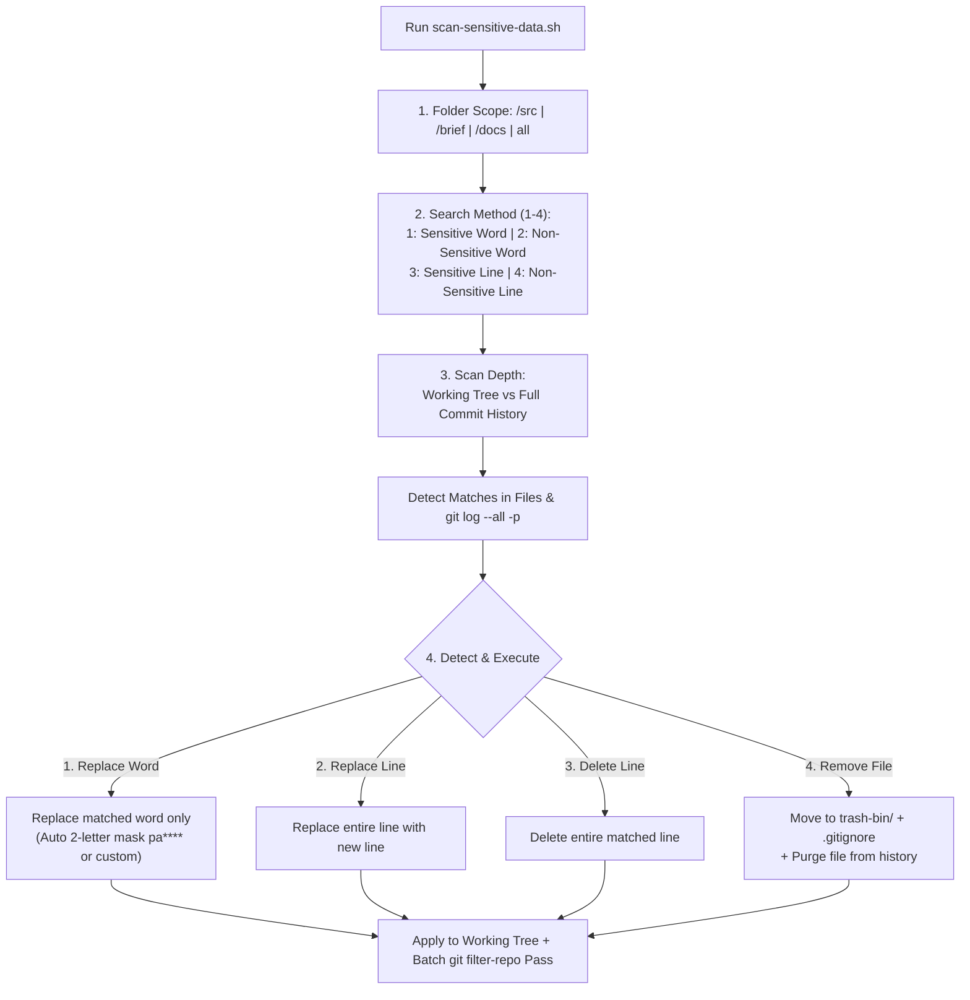

# 📌 Master Brief: Sensitive Data Scanner & Git History Sanitizer (all-lads-tool)

> **Feature Status**: `0` (Draft / Pending Implementation)  
> **Target Module**: all-lads-tool (`script/bash/scan-sensitive-data.sh`)  
> **Platform**: Cross-platform Bash (Git Bash on Windows / macOS / Linux)  
> **Date**: 2026-10-22  

---

## 1. Objective & Problem Statement
- **Problem**: Hardcoded sensitive data (emails, handles, tokens, machine paths, or secret lines) can leak into active working files and past Git commits across `/src`, `/brief`, or `/docs`. Developers need fine-grained control over **how patterns are searched** (case-sensitive vs. case-insensitive, word vs. whole line) and **how matches are remediated** (replace just the word, replace the whole line, delete the line, or remove the file).
- **Solution**: Build a self-contained Bash utility (`scan-sensitive-data.sh`) inside `all-lads-tool` that scans both the **working tree** and **full Git commit history** (`git log --all -p`) with:
  - **4 Folder Scopes**: `/src`, `/brief`, `/docs`, or `all`.
  - **4 Search / Detection Methods**:
    1. **Sensitive Word** (Case-sensitive word/token match)
    2. **Non-Sensitive Word** (Case-insensitive word/token match)
    3. **Sensitive Line** (Case-sensitive line match)
    4. **Non-Sensitive Line** (Case-insensitive line match)
  - **4 Detect & Execute Actions**:
    1. **Replace Word** (Replace only the matched word/token — custom text or 2-letter mask `pa****` / `dc******@gmail.com`)
    2. **Replace Line** (Replace the entire matched line with new text)
    3. **Delete Line** (Remove the entire line)
    4. **Remove Whole File** (Move local file to `trash-bin/`, untrack, `.gitignore`, and purge from Git history)

---

## 2. Interactive CLI Menu & Workflow Wireframe

```text
+----------------------------------------------------------------------------+
| ALL LADS TOOL -- SENSITIVE DATA SCANNER & GIT HISTORY SANITIZER            |
+----------------------------------------------------------------------------+
| [env] Git Bash (win32) | git 2.42+ | git-filter-repo: OK | Mode: Interactive|
+----------------------------------------------------------------------------+
| STEP 1: Select folder scope                                                |
|   [1] /src      (Source code & modules)                                    |
|   [2] /brief    (Architectural milestone briefs)                           |
|   [3] /docs     (Technical documentation & guides)                         |
|   [4] all       (Entire repository root & all subfolders)                  |
| > 4                                                                        |
+----------------------------------------------------------------------------+
| STEP 2: Select search / detection method (4 Methods)                       |
|   [1] Sensitive Word     (Case-sensitive word/token match)                 |
|   [2] Non-Sensitive Word (Case-insensitive word/token match)               |
|   [3] Sensitive Line     (Case-sensitive whole-line match)                 |
|   [4] Non-Sensitive Line (Case-insensitive whole-line match)               |
| > 2                                                                        |
| Enter search query (or press Enter for auto-detect rules): pa****          |
+----------------------------------------------------------------------------+
| STEP 3: Select scan depth                                                  |
|   [1] Working Tree Only   (Current files in folder scope)                  |
|   [2] Full Commit History (Working tree + all commits in git log --all)    |
| > 2                                                                        |
+----------------------------------------------------------------------------+
| [DETECTED 1/2] Scope: /docs | History: Working Tree + 3 Commits            |
|   File : docs/brief-deploy.md:14                                           |
|   Line : > Account: firebase: dc******@gmail.com | github: pa****          |
|   Word : pa****                                                            |
|                                                                            |
| Detect & Execute -- Choose action:                                         |
|   [1] Replace Word -> Replace only matched word (2-letter mask or custom)  |
|   [2] Replace Line -> Replace the entire line 14 with new line text        |
|   [3] Delete Line  -> Delete line 14 completely                            |
|   [4] Remove File  -> Move file to trash-bin/ & purge from git history     |
|   [s] Skip         -> Leave untouched                                      |
|   [q] Quit         -> Abort without changes                                |
| > 1                                                                        |
+----------------------------------------------------------------------------+
```

---

## 3. The 4 Search / Detection Methods

| Method ID | Method Name | Case Sensitivity | Match Granularity | Underlying CLI Flags (`grep` / `sed` / `perl`) | Best Used When |
| :---: | :--- | :--- | :--- | :--- | :--- |
| **`1`** | **Sensitive Word** | Case-Sensitive (`Aa != aa`) | Word / Token (`\bword\b` or token) | `grep -n` / `perl -pe 's/\Q$word\E/$rep/g'` | Matching exact variable names, API prefixes (`AIza...`, `ghp_...`), or exact handles |
| **`2`** | **Non-Sensitive Word** | Case-Insensitive (`Aa == aa`) | Word / Token | `grep -ni` / `perl -pe 's/\Q$word\E/$rep/gi'` | Finding a username, email, or keyword regardless of capitalization (`PA****`, `Pa****`, `pa****`) |
| **`3`** | **Sensitive Line** | Case-Sensitive (`Aa != aa`) | Whole Line (`^.*pattern.*$`) | `grep -n` / `sed "s/^.*${pat}.*$/${new_line}/"` | Matching an exact configuration line, import statement, or header block |
| **`4`** | **Non-Sensitive Line** | Case-Insensitive (`Aa == aa`) | Whole Line (`^.*pattern.*$`) | `grep -ni` / `perl -pe 's/^.*\Q$pat\E.*$/$new_line/i'` | Matching any line containing a secret phrase or log entry regardless of casing |

---

## 4. Detect & Execute: The 4 Remediation Actions

| Action ID | Action Name | Working Tree Execution (Current Files) | Git Commit History Execution (`--history`) | Scope Safety Notes |
| :---: | :--- | :--- | :--- | :--- |
| **`1`** | **Replace Word** | Replaces **only the matched word/token** inside the line, keeping the rest of the line intact:<br>• **`1a` Auto 2-Letter Mask**: `dc******@gmail.com`, `pa****`<br>• **`1b` Custom Word**: e.g. `process.env.SECRET` | Rewrites the matched word across all historical commits via `git filter-repo --replace-text` (`literal:` or `regex:`) | **Safest for `/src`**, `/brief`, and `/docs` — preserves surrounding code syntax |
| **`2`** | **Replace Line** | Replaces the **entire matched line** from start to end (`^.*$`) with user-supplied replacement line text | Rewrites matching full lines across historical commit blobs via blob callback / `replace-text` | Ideal for swapping out a hardcoded config assignment line (`const KEY = ...`) with a clean line |
| **`3`** | **Delete Line** | Removes the entire matched line (`sed -i "${LINE}d"`) | Strips the matching line across all historical commit blobs touching `<file>` | Safe in `/brief` and `/docs`; warns before deleting lines in `/src` (`.ts`, `.js`, `.json`) |
| **`4`** | **Remove Whole File** | 1. Moves file to `trash-bin/<timestamp>_<basename>` (**Zero Hard-Delete**)<br>2. Runs `git rm --cached --ignore-unmatch <file>`<br>3. Appends path to `.gitignore` | Purges `<file>` from every commit in repository history via `git filter-repo --invert-paths --path <file>` | Best for leaked `.env`, `.pem`, or credential dump files; requires `REMOVE` confirmation |

---

## 5. Folder Scopes (`/src`, `/brief`, `/docs`, `all`)

| Scope Option | Target Directory | Typical Use Case |
| :--- | :--- | :--- |
| **`/src`** | `src/` (or `<plugin>/src/`) | Replace hardcoded tokens/words (`Action 1: Replace Word`) or swap config lines (`Action 2: Replace Line`) without breaking TypeScript/JS builds |
| **`/brief`** | `brief/` | Sanitize architectural briefs using `Action 1: Replace Word` (2-letter mask) or `Action 3: Delete Line` |
| **`/docs`** | `docs/` (or `<plugin>/docs/`) | Sanitize markdown manuals and examples using `Action 1: Replace Word`, `Action 2: Replace Line`, or `Action 3: Delete Line` |
| **`all`** | Entire repository (`.`) | Full audit across all directories (automatically excludes `.git/`, `node_modules/`, and `trash-bin/`) |

---

## 6. Architecture & Execution Flow



### Safety & Privacy Guardrails
1. **2-Letter Privacy Exposure Rule**: Built-in `auto-mask` option formats sensitive strings to their first 2 characters + `*` (`dc******@gmail.com`, `pa****`, `fa******`) per [`.agents/rules/privacy-default-masking.md`](../../.agents/rules/privacy-default-masking.md).
2. **Idempotent Skip**: Tokens already masked (`^[a-zA-Z0-9]{2}\*{3,}`) are automatically ignored so repeated runs never double-mask.
3. **Pre-Sanitize Git Backup Ref**: Before rewriting commit history, a recovery ref `refs/backups/pre-sanitize-<timestamp>` is created automatically.
4. **Zero Hard-Delete Policy**: Removing a file (`Action 4`) always moves the working copy into `trash-bin/` rather than permanently deleting it.

---

## 7. CLI Flags & Non-Interactive Usage

```bash
# 1. Interactive menu (choose scope, 4 search methods, and detect & execute action)
bash all-lads-tool/script/bash/scan-sensitive-data.sh

# 2. Non-Sensitive Word search in /docs -> Replace Word with auto 2-letter mask
bash all-lads-tool/script/bash/scan-sensitive-data.sh \
  --scope docs --method non-sensitive-word --find "pa****" \
  --action replace-word --replace-with auto-mask --history

# 3. Sensitive Line search in /src -> Replace Line across working tree & commit history
bash all-lads-tool/script/bash/scan-sensitive-data.sh \
  --scope src --method sensitive-line --find "const API_KEY =" \
  --action replace-line --replace-with "const API_KEY = process.env.API_KEY;" --history

# 4. Non-Sensitive Line search in /brief -> Delete Line
bash all-lads-tool/script/bash/scan-sensitive-data.sh \
  --scope brief --method non-sensitive-line --find "debug token:" \
  --action delete-line --history

# 5. Remove whole file across working tree (to trash-bin/) and commit history
bash all-lads-tool/script/bash/scan-sensitive-data.sh \
  --scope all --file "src/secret.env" --action remove-file --history
```

### Parameter Summary
| Flag | Allowed Values | Default | Description |
| :--- | :--- | :--- | :--- |
| `--scope` | `src`, `brief`, `docs`, `all` | Interactive | Folder scope to scan |
| `--method` | `sensitive-word`, `non-sensitive-word`, `sensitive-line`, `non-sensitive-line` | Interactive | One of the 4 search adjustment methods |
| `--find` | string / pattern | Built-in detectors | Target word or line pattern to detect |
| `--action` | `replace-word`, `replace-line`, `delete-line`, `remove-file`, `prompt` | `prompt` | Detect & Execute remediation action |
| `--replace-with` | `auto-mask` or custom text | `auto-mask` | Replacement word (for `replace-word`) or full line (for `replace-line`) |
| `--history` | boolean flag | `false` | Also scan and rewrite full Git commit history (`git log --all -p`) |
| `--dry-run` | boolean flag | `false` | Preview detections without modifying files or commits |

---

## 8. Implementation Plan & Files (4-Pillar Alignment)

| File | Pillar | Status | Description |
| :--- | :--- | :---: | :--- |
| `docs/brief-sensitive-data-scanner.md` | `4. docs/` | ✅ | Master architectural brief (Status 0) |
| `docs/bash/scan-sensitive-data.md` | `4. docs/` | ✅ | Versi 3 technical documentation with 4 search methods & 4 actions |
| `script/bash/scan-sensitive-data.sh` | `3. script/` | ⏳ | Executable Bash scanner & Git history sanitizer |
| `skill/sensitive-data-scanner.md` | `1. skill/` | ⏳ | AI agent SOP for secret auditing and 2-letter privacy sanitization |
| `README.md` | Root Hub | ⏳ | Register `script/bash/` runtime category and `scan-sensitive-data.sh` |

---

## 9. Acceptance Criteria Checklist
- [x] Status 0 brief updated with the 4 Search Methods & 4 Detect-and-Execute Actions
- [x] Passes `audit-codebase.js` with 0 violations
- [ ] Folder scope supports `/src`, `/brief`, `/docs`, and `all`
- [ ] Implements all 4 search methods: `sensitive-word`, `non-sensitive-word`, `sensitive-line`, `non-sensitive-line`
- [ ] Implements all 4 execution actions: `replace-word`, `replace-line`, `delete-line`, `remove-file`
- [ ] Works on both current working tree files and full Git commit history (`--history`)
- [ ] Status 1 committed after implementation verification
